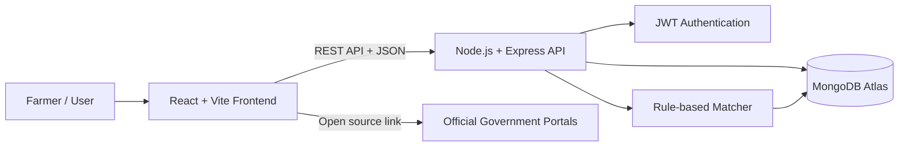
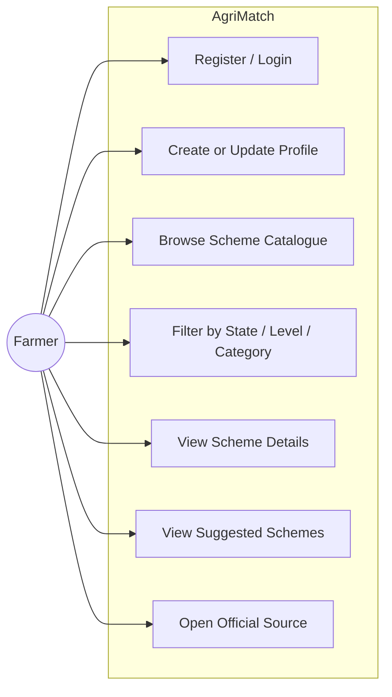
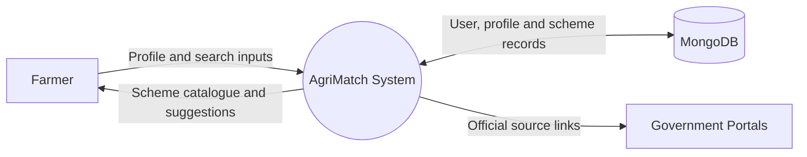
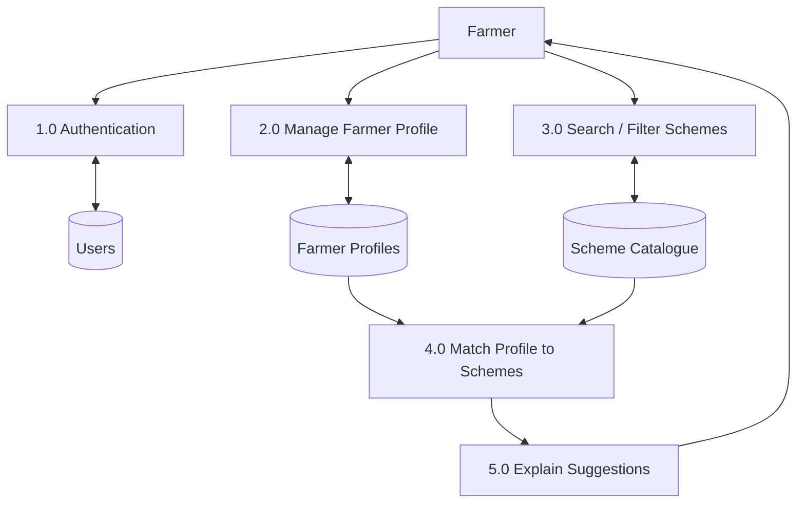
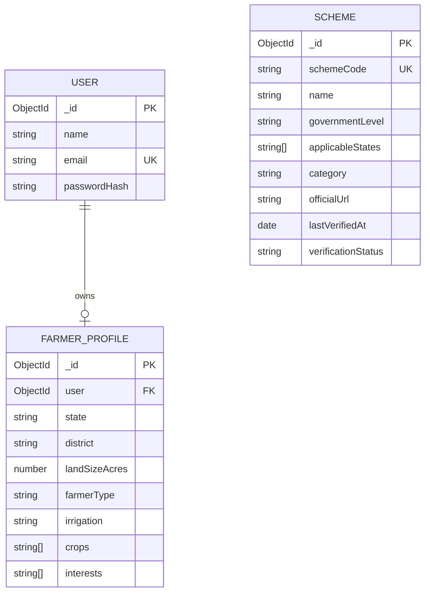
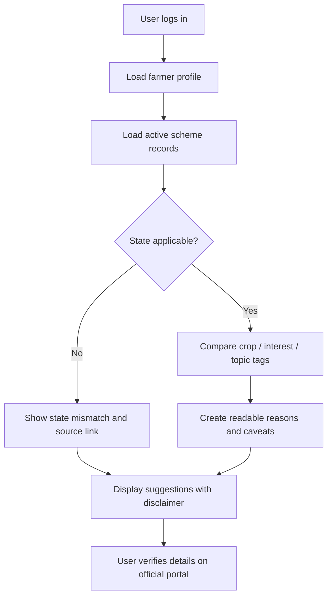

# Architecture and Diagrams

## System architecture

## Use-case diagram

## Data flow diagram — Level 0

## Data flow diagram — Level 1

## ER diagram

## Recommendation flow

## Database design notes
- `User` stores account details and a password hash, never a plain-text password.
- `FarmerProfile` has one profile per user (`user` is unique).
- `Scheme.schemeCode` is a stable unique identifier used by the seed script for upserts.
- `applicableStates` stores `All India` for nationwide records or state names for state-specific records.
- `lastVerifiedAt`, `sourceUrl` and `verificationStatus` make provenance visible.
